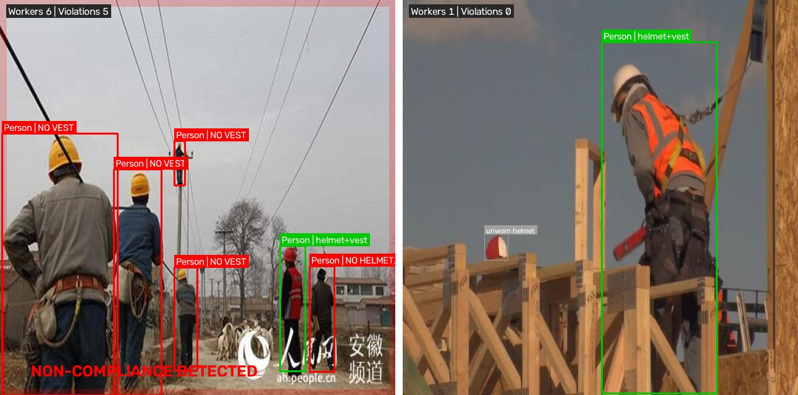
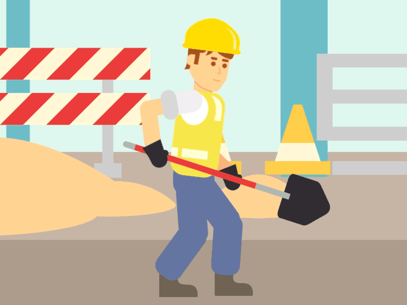
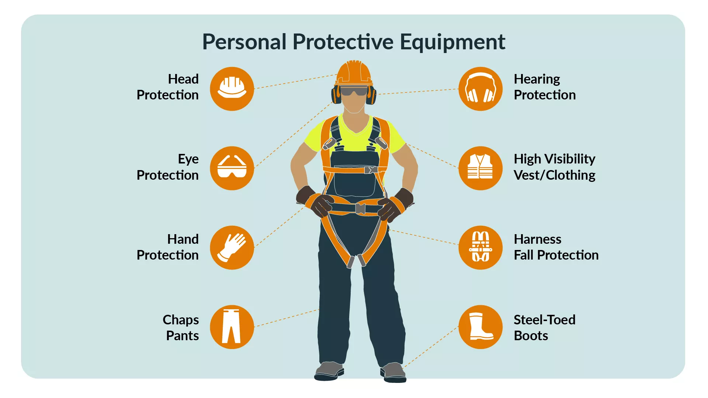
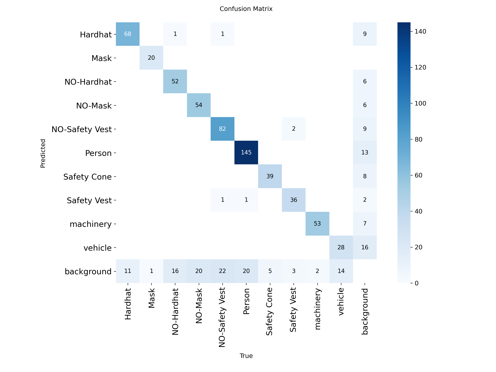
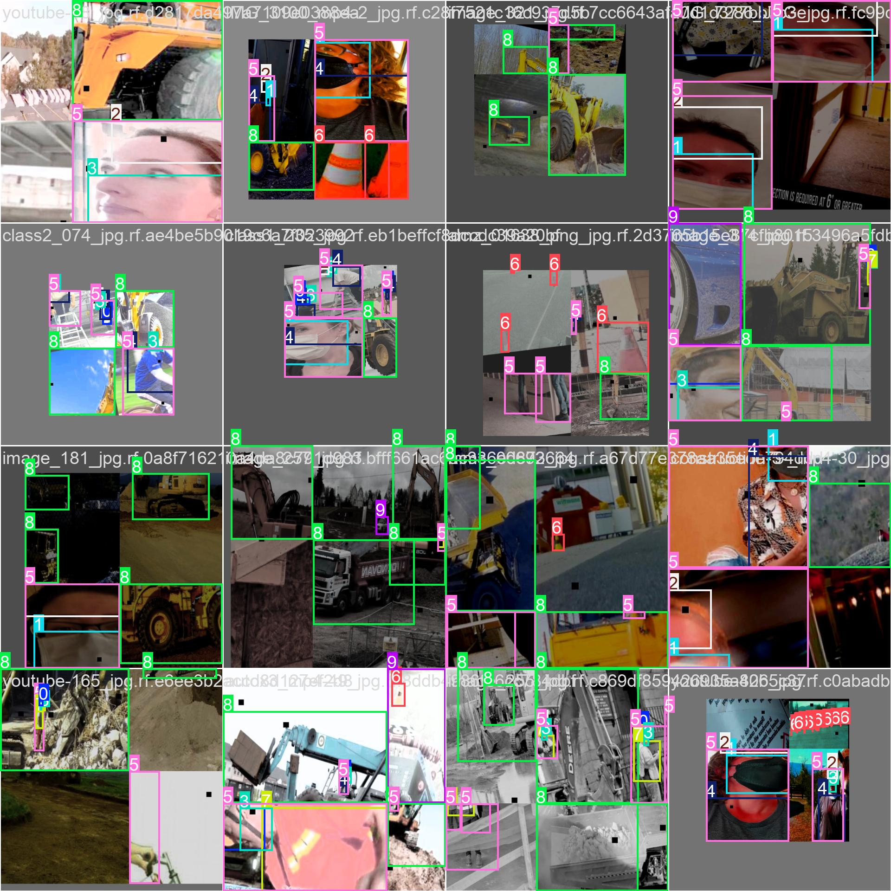
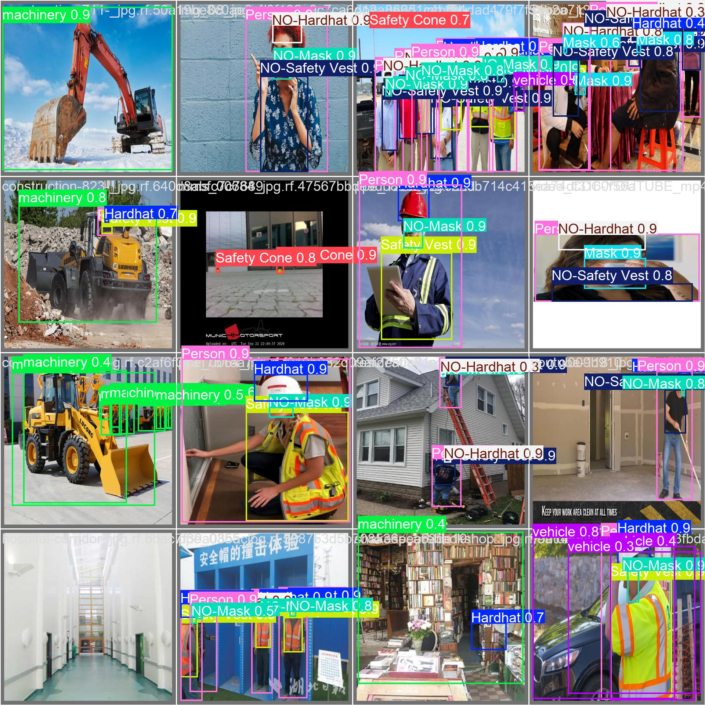
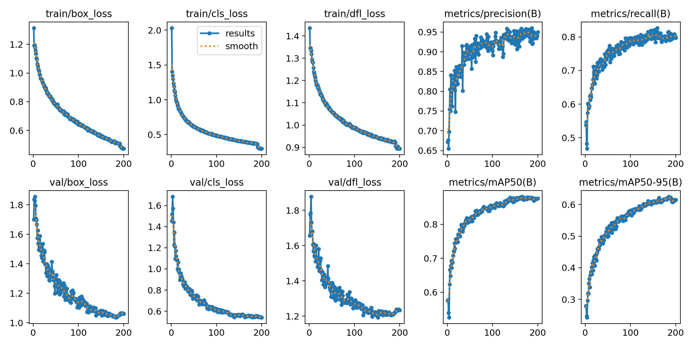

# SafeSite - Real-Time PPE Compliance Monitoring

[](https://github.com/Sourav-Nath-01/SafeSite-PPE-Monitor/actions/workflows/tests.yml)
[](https://github.com/Sourav-Nath-01/SafeSite-PPE-Monitor/actions/workflows/deploy.yml)
[](LICENSE)
[](https://www.python.org/)

Per-worker PPE compliance monitoring for construction sites: YOLOv8s detection,
ByteTrack worker identity, geometric person-to-PPE association, and a violation
audit trail with snapshots -- deployed on **Azure Container Apps** with
infrastructure as code (Bicep) and passwordless CI/CD from GitHub Actions.

**Live demo: https://ca-safesite.redhill-1f5f2c29.uaenorth.azurecontainerapps.io**
-- try it with your webcam, a construction-site photo or a video file. (It scales
to zero when idle, so the first visit can take up to a minute to wake it.)



*Held-out test images, annotated by the service. Left: each worker is judged on
their own -- one compliant, five missing a vest or helmet. Right: the helmet on
the beam is detected but belongs to no one, so it is shown as "unworn" instead
of counting toward compliance. Images: Construction Site Safety dataset
(Roboflow Universe), test split.*


> 4,764 workers died on the job in 2020 (3.4 per 100,000 full-time equivalent workers). Workers in transportation and material moving occupations and construction and extraction occupations accounted for nearly half of all fatal occupational injuries (47.4 percent), representing 1,282 and 976 workplace deaths, respectively. 
>
> *Occupational Safety and Health Administration (US Department of Labour)*


## Introduction

### Problem Statement
Construction site safety is a critical concern in the industrial sector. According to the **U.S. Occupational Safety and Health Administration (OSHA)**:
- **4,764 workers** died on the job in 2020 (3.4 per 100,000 full-time equivalent workers)
- **Workers in transportation, material moving, and construction** accounted for nearly **47.4% of fatal occupational injuries**
- **Construction and extraction workers** experienced **976 workplace deaths** in a single year

The primary cause of many preventable injuries and fatalities is **inadequate or improper use of Personal Protective Equipment (PPE)**.

### Solution
This project leverages **state-of-the-art deep learning** with **YoloV8** to automatically detect and verify that construction workers are wearing appropriate PPE in real-time. The system can be deployed as:
- **Automated safety monitoring** on construction sites
- **Real-time alerting** when workers lack proper equipment
- **Compliance reporting** and documentation
- **Risk assessment** for different construction zones

### Compliance Pipeline

Detection alone does not answer the question the system exists to ask. YOLO
reports that a helmet *and* a person are present; it does not report that *this
worker* is wearing *that helmet*. A helmet resting on a bench and a helmet on a
head produce identical frame-level counts.

The pipeline therefore runs four stages:

```
frame
  │
  ├─ 1. Detection      YOLOv8s -> person / PPE / NO-PPE boxes
  │
  ├─ 2. Tracking       ByteTrack -> stable worker ID across frames
  │
  ├─ 3. Association    each PPE box assigned to at most one person, by
  │                    containment score x body-region prior; unmatched
  │                    equipment reported as "unworn", never as compliance
  │
  └─ 4. Temporal logic per-track debounce -> a violation must persist N
                       seconds on the same worker before it is logged
```

**Why each stage matters**

| Stage | Failure it prevents |
|---|---|
| Association | A helmet on the ground marking a bare-headed worker compliant |
| Association | One compliant worker masking a violating one in the same frame |
| Region prior | A helmet at knee height being credited to the person above it |
| Greedy global assignment | Two adjacent workers sharing one helmet detection |
| Tracking | The same worker logged as dozens of separate violations |
| Debounce | A single dropped frame on a turning head raising an alert |

Each of these is covered by a named test in `Model-Deployment/tests/`.

**Association scoring.** IoU is the wrong metric here -- a correctly worn helmet
has near-zero IoU with the person box, because the helmet is tiny by comparison.
The score used instead is:

```
score = containment(ppe_box, person_box) x region_prior(ppe_type, position)

containment  = intersection_area / ppe_box_area
region_prior = 1.0 inside the expected vertical band of the person box,
               decaying linearly outside it
```

Expected bands, as a fraction of person-box height from the top: helmet
`0.00-0.35`, mask `0.00-0.40`, vest `0.10-0.80`. Pairs are committed
highest-score-first across the whole frame, so each PPE item belongs to exactly
one worker and adjacent workers keep their own equipment.

**Compliance modes.** `strict` flags any required item with no positive
detection on that worker (higher recall, the default for live monitoring).
`explicit` waits for an actual `NO-Hardhat`/`NO-Safety Vest`/`NO-Mask` detection
(higher precision on crowded or occluded scenes).

### Dataset
This project utilizes the [**Construction Site Safety Image Dataset**](https://universe.roboflow.com/roboflow-universe-projects/construction-site-safety) provided by Roboflow, a comprehensive collection of annotated construction site images:

- **Total Samples**: 2,801 professionally annotated images
- **Training Set**: 2,605 images for model training
- **Validation Set**: 114 images for performance monitoring
- **Test Set**: 82 images for final evaluation
- **Annotation Format**: YOLO v8 format with normalized bounding box coordinates

### Detectable Classes
The model is trained to detect **10 distinct classes** across construction sites:

| Safety Equipment | Non-Compliance | Scene Objects |
|-----------------|-----------------|---------------|
| **Hardhat** | NO-Hardhat | Person |
| **Mask** | NO-Mask | Vehicle |
| **Safety Vest** | NO-Safety Vest | Machinery |
| **Safety Cone** | - | - |

This multi-class detection enables comprehensive safety monitoring and risk identification.





## Setup

The model was trained on a local machine with an **NVIDIA RTX 5060 Ti (16GB VRAM)**. We utilized the `ultralytics` library by [**Ultralytics**](https://docs.ultralytics.com) to run YoloV8 custom object detection on the dataset.

### Training Configuration
- **Model Architecture**: YoloV8s (Small variant for balanced performance)
- **Total Epochs**: 200
- **Batch Size**: 16
- **Base Learning Rate**: 1e-3
- **Optimizer**: Auto (Adaptive optimizer selection)
- **Training Hardware**: NVIDIA RTX 5060 Ti with 16GB VRAM
- **Training Duration**: Approximately 1.92 hours for 200 epochs

### Key Technologies & Libraries
- **Ultralytics YoloV8**: State-of-the-art real-time object detection framework
- **PyTorch**: Deep learning framework backend
- **OpenCV (cv2)**: Image processing and annotation visualization
- **Pandas & Numpy**: Data manipulation and numerical operations
- **Matplotlib & Seaborn**: Advanced data visualization and training analysis
- **Flask**: Web deployment framework for the detection application

**Note:** This repository contains all results, visualizations, trained models, inference code, and comprehensive deployment infrastructure for production-ready PPE detection.

## Project Structure & Folders

### **Model-Training/** - Training Infrastructure & Dataset

Complete training pipeline with dataset and model artifacts.

#### **Training Notebook:**
- **`yolov8-finetuning-for-ppe-detection.ipynb`** (54 cells)
  - Comprehensive Jupyter notebook implementing the complete training workflow
  - **Data Loading & Preprocessing**:
    - Loads dataset in YOLO format
    - Validates image and label files
    - Creates data.yaml configuration
  - **Model Architecture Setup**:
    - Initializes YoloV8s pre-trained model
    - Configures transfer learning parameters
    - Sets up training hyperparameters
  - **Training Phase**:
    - 200 epochs with batch size of 16
    - Real-time loss and metric monitoring
    - Early stopping patience of 25 epochs
    - Learning rate scheduling with decay
  - **Validation & Evaluation**:
    - Per-epoch validation on 114 images
    - Confusion matrix generation
    - Per-class performance metrics
  - **Visualization & Analysis**:
    - Training curve plots (loss, mAP progression)
    - Sample batch visualization
    - Prediction examples on validation set
    - Performance comparison graphs
  - **Model Export**:
    - Best model checkpointing
    - Final model weights storage

#### **Dataset Organization:**
- **`Dataset/train/`** - Training Set (2605 images)
  - `images/`: JPG format training images from construction sites
  - `labels/`: Corresponding YOLO annotation files (.txt format)
    - Format: `[class_id] [center_x] [center_y] [width] [height]` (normalized coordinates)
    - Contains bounding box information for all PPE objects
  
- **`Dataset/valid/`** - Validation Set (114 images)
  - `images/`: JPG format validation images
  - `labels/`: YOLO format validation annotations
  - Used for monitoring model performance during training
  - Helps detect overfitting
  
- **`Dataset/test/`** - Test Set (82 images)
  - `images/`: JPG format test images
  - `labels/`: YOLO format test annotations
  - Reserved for final model evaluation
  - Represents unseen data for unbiased performance assessment

#### **Training Outputs:**
- **`Outputs/data.yaml`** - Dataset Configuration
  ```yaml
  path: ./Dataset
  train: ./Dataset/train
  val: ./Dataset/valid
  test: ./Dataset/test
  nc: 10
  names: ['Hardhat', 'Mask', 'NO-Hardhat', 'NO-Mask', 'NO-Safety Vest', 
          'Person', 'Safety Cone', 'Safety Vest', 'machinery', 'vehicle']
  ```

- **`Outputs/runs/detect/yolov8s_ppe_css_200_epochs/`** - Training Results
  - `confusion_matrix.png`: Per-class detection accuracy heatmap
  - `results.png`: Loss curves and metric progression across 200 epochs
  - `train_batch*.jpg`: Sample detections from training batches
  - `val_batch*_pred.jpg`: Model predictions on validation set
  - `val_batch*_labels.jpg`: Ground truth labels for reference
  - `results.csv`: Detailed epoch-by-epoch metrics

- **`Outputs/training_log_df.csv`** - Complete Training Log
  - 200 rows (one per epoch) with 15 metrics columns:
    - `epoch`: Training epoch number (1-200)
    - `time`: Cumulative training time
    - `train/box_loss`: Bounding box regression loss
    - `train/cls_loss`: Classification loss
    - `train/dfl_loss`: Distribution focal loss
    - `metrics/precision(B)`: Precision score
    - `metrics/recall(B)`: Recall score
    - `metrics/mAP50(B)`: mAP at 50% IoU threshold
    - `metrics/mAP50-95(B)`: mAP across IoU 50-95%
    - `val/box_loss`: Validation box loss
    - `val/cls_loss`: Validation classification loss
    - `val/dfl_loss`: Validation DFL loss
    - `lr/pg0/pg1/pg2`: Learning rates for parameter groups
  - Enables analysis of training dynamics and convergence

#### **Pre-trained Model Weights:**
Stock COCO checkpoints (`yolov8s.pt`, `yolo11n.pt`) are **not** committed --
Ultralytics downloads them automatically on first use. `yolov8s.pt` is the
transfer-learning starting point; `yolo11n.pt` is a lighter alternative worth
benchmarking for edge deployment.

### **Model-Deployment/** - Real-Time Monitoring Service

Flask + SocketIO application that turns the detector into a per-worker
compliance monitor with a reviewable violation log.

#### **Core Application Files:**

- **`ppe_association.py`** - Person <-> PPE association (no ML dependencies)
  - `associate()`: assigns every PPE box to at most one person via greedy
    global matching on `containment x region_prior`
  - `containment()` / `iou()`: box geometry primitives
  - `PersonObservation`: one worker in one frame, with the PPE evidence
    attributed to them and their `evaluate()` compliance verdict
  - `CLASS_MAP`: dataset class names -> `(canonical PPE type, worn?)`, so both
    `Hardhat` and `NO-Hardhat` resolve to the `helmet` requirement
  - Deliberately free of torch/OpenCV/numpy imports, which is what makes the
    logic unit-testable without a GPU, a model or a camera

- **`detection_logic.py`** - Temporal state machine
  - `InstanceDetector`: owns one `TrackState` per tracked worker, each with its
    own debounce timer, violation instance ID and snapshot counter
  - Violations are confirmed only after persisting `non_compliance_delay`
    seconds on the *same* track; tracks are evicted after
    `instance_reset_timeout` seconds out of frame
  - Returns a per-worker breakdown (`persons`), the confirmed `violations`, and
    `unassigned_ppe` for equipment that matched nobody
  - `SnapshotManager`: writes annotated violation frames to `snapshots/`

- **`visualization.py`** - Compliance overlay
  - Draws one box per *worker*, coloured by that worker's own state:
    green compliant, amber inside the debounce window, red confirmed violation
  - Greys out unassigned PPE, making the association decision visible in a demo
  - HUD with live FPS, per-frame inference time, headcount and violation count

- **`app.py`** - Flask + Socket.IO service. Three frame sources, one pipeline:

  | Source | Transport | Where it works |
  |---|---|---|
  | Browser webcam / local video file | Socket.IO `client_frame` (WebSocket) | anywhere, including the cloud |
  | Single image upload | `POST /api/detect` (stateless, nothing stored) | anywhere |
  | Site camera, RTSP URL or server-side file | MJPEG `/video_feed` | on-prem (`PPE_VIDEO_SOURCE`) |

  - `MonitorSession`: every video source gets its own model instance (ByteTrack
    state lives on it), detector, debounce timers and snapshot rate limits, so
    concurrent visitors never share worker IDs or alerts
  - Backpressure: the browser sends its next frame only when the previous result
    returns, so a slow server lowers the frame rate instead of building a queue
  - Inference is serialised behind one lock; torch already uses every core
  - Public-demo mode (`PPE_PUBLIC_DEMO`): visitors see only their own violations
    (anonymous signed-cookie ID), settings are read-only, the site camera is off,
    and snapshots are purged after `PPE_RETENTION_HOURS`
  - Admin (`PPE_ADMIN_PASSWORD`, HTTP Basic over TLS) for settings and the
    all-visitors review view (`/review?all=1`)
  - Snapshots are served by bare file name through `send_from_directory`, never
    by path; `/healthz` backs the container probes
- **`settings_schema.py`** - defaults, validation and atomic persistence for the
  settings the detection loop reads every frame (bad input is a 400, not a
  crashed stream)
- **`gunicorn.conf.py`** - one worker, threaded: session state is in-process

- **`database.py`** - SQLite persistence
  - Tables: `instances`, `snapshots`, `alerts`; rows read by column name
  - `_migrate()`: adds `track_id` and `owner` columns in place on existing databases
  - Sort parameters are whitelisted (they are interpolated into `ORDER BY`)
  - `purge_older_than()`: retention for the public demo

- **`tests/`** - 72 unit tests, no model or GPU required
  - `test_ppe_association.py` (23): geometry, class mapping, region priors,
    adjacent-worker assignment, the helmet-on-the-ground regression
  - `test_detection_logic.py` (24): debounce, per-track independence, track
    eviction, instance-ID uniqueness across sessions, compliance modes,
    single-image evaluation
  - `test_database.py` (14): migration, sort whitelist, snapshot counts, visitor
    isolation, retention
  - `test_settings_schema.py` (11): validation and settings-file recovery
  - Time is injected by monkey-patching `time.time`, so the temporal tests are
    deterministic rather than sleep-based

#### **Templates:**
- **`index.html`** - Live dashboard: per-worker cards showing ID, worn PPE,
  missing PPE, debounce progress and instance ID, plus the FPS/latency readout
- **`review.html`** - Violation history with snapshots
- **`settings.html`** - Required PPE, debounce delay, reset timeout, compliance
  mode, confidence threshold and tracking toggle

### **Model-Testing/** - Evaluation & Benchmarking

- **`evaluate.py`** - Held-out test-set evaluation
  - Runs on the 82-image `test` split that no model selection touched, and
    prints a per-class table sorted weakest-first, because an aggregate mAP@50
    of 0.82 hides a `NO-Hardhat` recall of 0.64
  - `resolve_data_yaml()` rewrites the dataset yaml with absolute split paths,
    so evaluation is reproducible from any working directory
  - Usage: `python evaluate.py --split test --markdown ../metrics_test.md`

- **`benchmark.py`** - Latency & throughput benchmark
  - Reports p50/p95/p99 latency and sustained FPS per export format; mean
    latency alone hides the tail that causes dropped frames
  - Warmup iterations and `torch.cuda.synchronize()` before each measurement,
    without which CUDA timings measure queue submission rather than compute
  - Usage: `python benchmark.py --formats pt onnx --device 0 --runs 200`

- **`checker.py`** - CUDA availability and device report
- **`test_cam.py`** - Raw detector on a webcam feed (no compliance logic)
- **`test_single.py`** - Single-image inference

### **assets/**
Repository documentation assets:
- Training visualizations, GIFs, and images used in README

### **Root Files**
- **`requirements.txt`**: Runtime dependencies
- **`requirements-long.txt`**: Install order, including the CUDA-matched PyTorch wheel
- **`run_tests.sh`**: Runs the 72-test suite (no model or GPU needed)
- **`Dockerfile`** / **`.dockerignore`**: CPU container (non-root, gunicorn, health check)
- **`infra/`**: Bicep template and one-time bootstrap script for Azure
- **`.github/workflows/`**: tests + Bicep compile on every push; deploy to Azure after tests pass
- **`README.md`**: Project documentation and usage guide
- **`LICENSE`**: Project licensing information


## Repository Structure

```
Construction-Site-Safety-PPE-Detection/
├── Model-Training/
│   ├── Dataset/{train,valid,test}/{images,labels}/
│   ├── Outputs/
│   │   ├── data.yaml
│   │   └── runs/detect/yolov8s_ppe_css_200_epochs/
│   │       └── weights/best.pt        # committed; .onnx/.engine are exports
│   │       ├── confusion_matrix.png, results.png, Box*_curve.png
│   │       └── results.csv
│   └── yolov8-finetuning-for-ppe-detection.ipynb
│
├── Model-Deployment/
│   ├── ppe_association.py     # person <-> PPE geometry (dependency-free)
│   ├── detection_logic.py     # per-track debounce & violation state machine
│   ├── visualization.py       # compliance overlay + HUD
│   ├── app.py                 # Flask + Socket.IO service
│   ├── settings_schema.py     # settings validation & persistence
│   ├── database.py            # SQLite persistence & migrations
│   ├── gunicorn.conf.py       # production server config
│   ├── templates/{index,review,settings}.html
│   └── tests/
│       ├── test_ppe_association.py
│       ├── test_detection_logic.py
│       ├── test_database.py
│       └── test_settings_schema.py
│
├── Model-Testing/
│   ├── evaluate.py            # held-out test-split metrics, per class
│   ├── benchmark.py           # p50/p95/p99 latency & FPS per format
│   ├── checker.py, test_cam.py, test_single.py
│
├── infra/
│   ├── main.bicep             # Container Apps, ACR, Log Analytics, identities
│   └── bootstrap.sh           # one-time setup, run in Azure Cloud Shell
├── .github/workflows/
│   ├── tests.yml              # unit tests + Bicep build
│   └── deploy.yml             # build -> ACR -> Container Apps, via OIDC
├── Dockerfile
├── run_tests.sh
├── requirements.txt
└── README.md
```

## Training Results & Performance Metrics

### Model Performance (200 Epochs)

The YoloV8s model underwent comprehensive training for **200 epochs** on the construction site safety dataset using an NVIDIA RTX 5060 Ti GPU. The training process completed in approximately **1.92 hours**, demonstrating efficient transfer learning.

#### Held-out test split (82 images, never used for training or model selection)

Produced by `python Model-Testing/evaluate.py --split test`. The validation
figures are shown alongside for reference only: the checkpoint was *selected* on
the validation split, so those numbers are optimistic by construction.

| Metric | Validation (114 img) | **Test (82 img)** |
|--------|-------|-------|
| **Precision** | 0.950 | **0.924** |
| **Recall** | 0.798 | **0.790** |
| **mAP@50** | 0.877 | **0.816** |
| **mAP@50-95** | 0.615 | **0.555** |

Per class on the test split, weakest first:

| Class | Precision | Recall | mAP@50 | mAP@50-95 |
|---|---|---|---|---|
| Safety Cone | 0.855 | 0.514 | 0.532 | 0.270 |
| NO-Hardhat | 0.840 | 0.640 | 0.637 | 0.393 |
| NO-Mask | 0.908 | 0.759 | 0.823 | 0.465 |
| vehicle | 0.872 | 0.854 | 0.873 | 0.565 |
| Mask | 0.965 | 0.750 | 0.776 | 0.580 |
| NO-Safety Vest | 0.946 | 0.800 | 0.842 | 0.594 |
| Person | 0.930 | 0.874 | 0.913 | 0.617 |
| Hardhat | 1.000 | 0.927 | 0.950 | 0.659 |
| machinery | 0.974 | 0.859 | 0.883 | 0.705 |
| Safety Vest | 0.954 | 0.918 | 0.932 | 0.706 |

#### What the numbers mean for compliance

- **The positive PPE classes are the reliable ones.** `Hardhat` (P 1.00, R 0.93)
  and `Safety Vest` (P 0.95, R 0.92) are the strongest classes, and `Person`
  recall is 0.87 -- the three detections the association step depends on.
- **The explicit violation class is weak.** `NO-Hardhat` recall is 0.64: the
  model misses about one bare head in three. A system that only alerted on
  `NO-Hardhat` boxes would miss a third of violations.
- **That is why `strict` is the default compliance mode.** Strict mode flags a
  worker when no *positive* helmet is associated with them, so it rests on the
  0.93-recall `Hardhat` class rather than the 0.64-recall `NO-Hardhat` class.
  `explicit` mode (alert only on `NO-*` boxes) trades that recall for precision.
- **Small objects suffer most.** `Safety Cone` is the weakest class overall;
  cones are small and frequently partly occluded. They are scene context here,
  not a compliance input.
- **Validation-to-test drop** of 0.06 mAP@50 is the expected cost of reporting
  on data the checkpoint was not chosen on. With 82 test images, treat
  per-class figures as indicative (wide confidence intervals).

#### Inference performance

Throughput is a deployment decision, not a footnote: a model that cannot keep up
with the camera drops the frames a violation occurs in. Measure it on your own
hardware before quoting it:

```bash
python Model-Testing/benchmark.py --formats pt onnx --runs 200
```

The benchmark reports p50/p95/p99 latency and sustained FPS per export format.
The live dashboard shows the same two numbers continuously while streaming.

### Training Characteristics:
- **Data Split**: Train: 2605 images | Valid: 114 images | Test: 82 images
- **Batch Processing**: 16 images per batch
- **Hardware Utilization**: NVIDIA RTX 5060 Ti efficiently processed batches with 16GB VRAM
- **Convergence**: Model achieved plateau around epoch 150-180, with final epochs showing stability
- **Classes Detected**: 10 PPE and non-PPE classes including Hardhat, Mask, Safety Vest, Person, Vehicle, Machinery, etc.

### Visualization Results

#### Confusion Matrix
Shows the model's classification accuracy across all 10 PPE classes:



#### Training Batch Samples
Visual examples of detected PPE during training batches:



#### Validation Batch Predictions
Model predictions on validation set with bounding boxes and confidence scores:



#### Training Curves
Loss and metric progression across all 200 epochs:



## Deployment & Usage

### Getting the dataset & weights

The trained detector (`best.pt`, 21 MB) **is** committed, so inference and the
web app work straight after cloning. The training data is not -- 166 MB of
imagery is not this repository's to redistribute:

```bash
# Download from Roboflow, then unpack so the layout is:
#   Model-Training/Dataset/{train,valid,test}/{images,labels}/
# https://universe.roboflow.com/roboflow-universe-projects/construction-site-safety
```

Only `evaluate.py` and retraining need the dataset. To regenerate the ONNX
export used by the benchmark:

```bash
yolo export model=Model-Training/Outputs/runs/detect/yolov8s_ppe_css_200_epochs/weights/best.pt format=onnx
```

### Install

```bash
# PyTorch first, matched to your CUDA version (see requirements-long.txt)
pip install -r requirements.txt
```

### Run the monitoring service

```bash
cd Model-Deployment
python app.py           # http://localhost:3333 (development server)
```

Pick a source on the dashboard: **Webcam** or **Video file** (streamed from the
browser), **Image**, or **Site camera** (the server's own camera, see
`PPE_VIDEO_SOURCE`). The dashboard shows one card per tracked worker with their
ID, the PPE they are wearing, what they are missing, and live FPS / per-frame
latency. Violations are written to `detections.db` with an annotated snapshot
and are browsable at `/review`.

### Configuration

All optional; the defaults reproduce a local, single-user install.

| Variable | Default | Purpose |
|---|---|---|
| `PPE_PUBLIC_DEMO` | `false` | Per-visitor isolation, read-only settings, no site camera |
| `PPE_ADMIN_PASSWORD` | _(unset)_ | Enables the `admin` login for settings and the all-visitors view |
| `PPE_SECRET_KEY` | random per process | Signs the session cookie |
| `PPE_DATA_DIR` | `Model-Deployment/` | Where the database, snapshots and settings live |
| `PPE_VIDEO_SOURCE` | `0` | Site camera: webcam index, RTSP URL or video file (files loop) |
| `PPE_SERVER_CAMERA` | `true` unless demo | Show the site-camera source |
| `PPE_MAX_SESSIONS` | `4` | Concurrent browser video sessions |
| `PPE_RETENTION_HOURS` | `0` (keep) | Purge violations older than this |
| `PPE_MODEL_PATH` | 200-epoch `best.pt` | Override the weights |
| `PPE_SECURE_COOKIES` | `false` | Set `true` behind HTTPS |

### Run in Docker

```bash
docker build -t safesite .
docker run -p 3333:3333 -e PPE_PUBLIC_DEMO=true safesite    # http://localhost:3333
```

The image runs gunicorn as a non-root user and keeps its data in `/data`
(mount a volume there to persist it).

The image is CPU-only by default; for GPU inference swap the base image for
`nvidia/cuda:12.4.1-runtime-ubuntu22.04`, install the CUDA torch wheel and run
with `--gpus all`.

### Run the tests

```bash
./run_tests.sh
```

72 tests covering association geometry, the temporal state machine, the
database layer and settings validation. They import no torch, OpenCV or numpy
and need no weights, so they run in well under a second in CI.

## Deploying to Azure

```
 GitHub push ─► tests (unit + Bicep build) ─► deploy workflow
                                                │ OIDC login (no stored secret)
                                                │ docker build ─► Azure Container Registry
                                                ▼
                         Azure Container Apps  (HTTPS ingress, WebSockets, scale 0-1)
                         └─ container: gunicorn + Flask-SocketIO + YOLOv8s (CPU)
                              │ pulls image with a managed identity (AcrPull)
                              └─ logs ─► Log Analytics
```

Everything is defined in [`infra/main.bicep`](infra/main.bicep). Container Apps
fits this workload: it supports WebSockets, terminates TLS (needed for browser
camera access), and scales to zero, so an idle demo costs almost nothing.

**One-time setup** (about 5 minutes; Azure Cloud Shell has every tool needed):

```bash
git clone https://github.com/<you>/<repo>.git && cd <repo>
./infra/bootstrap.sh <you>/<repo>      # LOCATION=centralindia by default
```

This creates the resource group, container registry, Container Apps
environment, Log Analytics workspace and two managed identities (one to pull
images, one federated with GitHub for deploys), then sets the `AZURE_*`
repository variables (or prints them for you to add).

**Deploy:** push to `main`, or run `gh workflow run deploy.yml`. The workflow
builds the image, pushes it, re-applies the Bicep template with the new tag,
smoke-tests `/healthz` and puts the URL in the run summary.

Optional repository settings: secret `PPE_ADMIN_PASSWORD`; variables
`AZURE_MIN_REPLICAS` (`1` keeps the demo warm, no cold start) and `AZURE_CPU`
(`0.5`-`2.0`).

**Cost (rough estimate - check the Azure pricing calculator for your region):**
with `minReplicas=0` the app mostly falls inside the Container Apps monthly free
grant, leaving the Basic registry (about US$5/month) as the main cost. Keeping
one replica warm (`AZURE_MIN_REPLICAS=1`, 1 vCPU / 2 GiB) adds idle-rate compute,
on the order of US$20-25/month. `az group delete -n rg-safesite` removes
everything.

**Operations:**

```bash
az containerapp logs show -g rg-safesite -n ca-safesite --follow   # live logs
az containerapp revision list -g rg-safesite -n ca-safesite -o table
```

### Evaluate and benchmark

```bash
cd Model-Testing

# Held-out test split, per-class breakdown
python evaluate.py --split test --markdown ../metrics_test.md

# Latency percentiles and FPS, PyTorch vs ONNX
python benchmark.py --formats pt onnx --runs 200 --markdown ../latency.md

# Raw detector sanity checks
python checker.py        # CUDA/device report
python test_cam.py       # webcam, detections only
python test_single.py    # one image
```

### Retrain

```
Model-Training/yolov8-finetuning-for-ppe-detection.ipynb
```

## Dataset Information

**Construction Site Safety Image Dataset** sourced from [Roboflow](https://universe.roboflow.com/roboflow-universe-projects/construction-site-safety):
- **Total Images**: 2,801 annotated images
- **Classes**: 10 categories including PPE and non-PPE objects
- **Annotation Format**: YOLO format with normalized coordinates
- **Diversity**: Wide variety of construction site scenarios, lighting conditions, and worker configurations
- **Quality**: Professional annotations with high inter-rater agreement

## Limitations

Stated plainly, because they bound what the system can honestly claim:

- **Region priors assume upright, roughly frontal workers.** A crouching or
  prone worker can push a correctly worn helmet outside the expected band. The
  priors are constants in `ppe_association.py` and can be swept against a
  labelled set rather than hand-tuned.
- **Association is 2D and monocular.** With significant depth separation, a
  helmet on a distant worker can overlap a nearer person's box. Multi-view or
  depth input would resolve it; a single fixed camera cannot.
- **No pose estimation.** Keypoints would place the head and torso far more
  reliably than a box-fraction prior, at extra inference cost.
- **The test split is 82 images.** Metrics from it carry wide confidence
  intervals; treat per-class numbers as indicative, not precise.
- **Dataset domain.** Roboflow CSS imagery skews toward daylight and clear
  weather; night, rain, and high-visibility-clothing variation are
  under-represented.
- **Single replica.** Socket.IO sessions and tracker state live in process
  memory, so the deployment is pinned to one replica (a few concurrent visitors
  on CPU). Scaling out would need sticky sessions plus a message queue, or
  inference moved to a separate worker pool.
- **Ephemeral storage in the cloud.** The SQLite log and snapshots live in the
  container's filesystem; a restart or scale-to-zero clears them. That suits a
  public demo (and its privacy); a production deployment would move to Azure
  Database for PostgreSQL and Blob Storage.
- **CPU inference.** Roughly 300 ms per frame for YOLOv8s on one vCPU, i.e. a
  few FPS per visitor. An ONNX Runtime image or a GPU workload profile would
  raise it.

## Future Enhancements

1. **Pose-based association**: Replace vertical-band priors with YOLO-pose
   keypoints, so helmet checks anchor to the actual head position
2. **Sweep association thresholds**: Tune `MIN_CONTAINMENT` and the region bands
   against a labelled compliance set instead of setting them by hand
3. **Quantization**: INT8 / TensorRT export, reporting the mAP cost alongside
   the latency gain
4. **Model comparison**: YOLOv8n / v8m / v11 under identical settings, as an
   accuracy-vs-latency curve rather than a single point
5. **Multi-camera support**: Move inference onto a worker queue so one process
   can serve several feeds and the web tier can scale past one replica
6. **Edge deployment**: Jetson / Raspberry Pi with the quantized export
7. **Alert integrations**: Email, SMS or webhook fan-out on confirmed violations

## Attribution

The original PPE detection project, dataset preparation and initial Flask
application are the work of upstream authors and are used under the MIT License
(see [LICENSE](LICENSE)). Dataset: [Construction Site Safety Image
Dataset](https://universe.roboflow.com/roboflow-universe-projects/construction-site-safety)
by Roboflow.

Work added in this fork: the person-to-PPE association module, ByteTrack
integration and per-track temporal state machine, the compliance visualization
layer, browser-fed video and image inference with per-visitor sessions, the
72-test suite, the test-split evaluation and latency benchmarking scripts, the
SQLite migrations, containerization, and the Azure deployment (Bicep + GitHub
Actions).
